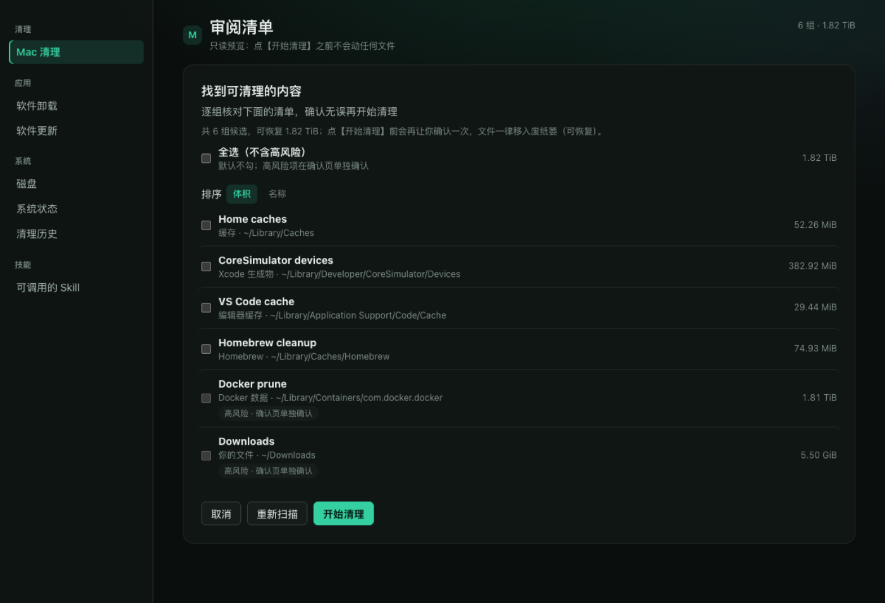

[中文](README.md) · **English**

# For AI

A macOS cleanup / uninstall / update tool. Three entry points, one kernel:
**scanning is read-only, every deletion goes to the Trash**.

- CLI: `maccleaner audit | plan | clean | uninstall | updates | trace | ui`
- MCP: `maccleaner-mcp` (7 tools, stdio)
- Local UI: `maccleaner ui`

Plan first, then apply: `plan_storage` returns a `plan_id`; `apply_storage_plan` requires
`approved_targets`, and the `plan_id` expires after 15 minutes. High-risk targets
(`~/Downloads`, Docker data) need an explicit confirmation. `~/.ssh`, Keychains and browser
login data never show up in the list.

<h2 id="installation">Install</h2>

macOS + Python 3.10+. The core CLI has no third-party dependencies.

```bash
pipx install maccleaner
```

Not on PyPI yet — install from source:

```bash
pipx install "git+https://github.com/Matoya-Amadeus/MacCleaner.git"
```

For AI clients (MCP): `pipx install "maccleaner[mcp]"`

Native window instead of a browser tab: `bash scripts/install_launcher.sh` → `~/Applications/MacCleaner.app`

Build offline artifacts yourself:

```bash
python3 -m pip install wheel
python3 -m build --no-isolation
```

# For humans



EMM... just a plain cleanup tool, and AI can call it directly.

## The window

Open `~/Applications/MacCleaner.app`, or run `maccleaner ui`. Seven entries in the sidebar:

- **Mac Cleanup**: scan → tick items → confirm → done
- **Uninstall**: inspect leftovers one by one, or batch-uninstall
- **Updates**: grouped by source; apps with Sparkle update themselves first
- **Disk**: capacity, drill down level by level
- **System**: load, memory, top CPU processes
- **History**: one row per cleanup receipt
- **Skills**: agent skills installed here

`⌘A` select all, `Shift+click` range select, `Enter` primary action, sort by size/name,
right-click to copy the path or reveal it in Finder.

## CLI

```bash
maccleaner audit                      # read-only
maccleaner plan                       # items with target_id / risk / reason
maccleaner clean --apply --yes        # actually remove (low-risk by default)
maccleaner uninstall --app-path /Applications/Foo.app --apply
maccleaner updates --apply --only aom,cmake
maccleaner trace <plan_id>            # what a given plan did
```

## MCP

```json
{"name": "audit_storage", "arguments": {"profile": "generic"}}
{"name": "plan_storage", "arguments": {"profile": "generic"}}
{"name": "apply_storage_plan", "arguments": {
  "plan_id": "<from plan_storage>",
  "approved_targets": ["home-caches"]
}}
```

Client configuration: [docs/mcp.md](docs/mcp.md).

## Verify it yourself

```bash
python3 -m unittest discover -s tests -v
```

GUI acceptance scripts (manual): `bash tests/acceptance_native_smoke.sh` (11 steps incl. a real cleanup),
`tests/acceptance_uninstall_batch.py`, `tests/acceptance_quit.sh`, `tests/acceptance_portability.sh`,
`tests/acceptance_package.sh`.

## Safety and privacy

No telemetry. The UI binds to `127.0.0.1` only, behind a one-time entry link. See [PRIVACY.md](PRIVACY.md).

---

Maintained jointly by **AI·Maho** and **Human·Matoya**
