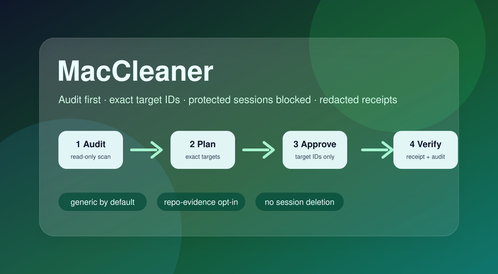

# MacCleaner

<p align="center">
  
</p>

> **Inspect first. Approve exact targets. Clean only what you selected.**
>
> MacCleaner audits macOS storage, builds an exact target list, and applies only items that pass the safety gates.

[中文](README.md) · [English](README.en.md)

<details>
<summary><strong>Recent notes</strong></summary>

Update time: 2026-07-12 00:28

Update content: Added an installable CLI, optional stdio MCP server, and one-time plan-token safety chain.

### 2026-05-19 21:20

Update content: Added the generic default profile, opt-in repo-evidence profile, protected-session blocking, receipts, backups, and post-cleanup residual validation.

</details>

## Contents

- [At a glance](#at-a-glance)
- [Beginner: tell your AI this](#ai-prompt-quick-start)
- [What it solves](#what-it-solves)
- [Installation](#installation)
- [Quick start](#quick-start)
- [Using the CLI](#using-the-cli)
- [Using MCP](#using-mcp)
- [Common scenarios](#common-scenarios)
- [Safety boundaries](#safety-boundaries)
- [Configuration and options](#configuration-and-options)
- [Reading reports](#reading-reports)
- [Structure and workflow](#structure-and-workflow)
- [Developer notes](#developer-notes)
- [FAQ](#faq)

## At a glance

| Who are you? | Start here | Result |
| --- | --- | --- |
| Beginner with MCP connected to AI | Copy the first prompt below | Your AI shows a list first and does not clean |
| Prefer a terminal | [Quick start](#quick-start) | Follow `audit → plan → apply` |
| Need precise control | [Using the CLI](#using-the-cli) / [Using MCP](#using-mcp) | Only exact targets you approve can run |

> **Want the safe first step?** After connecting MCP, copy only the first prompt below. It lists candidates first; no confirmation means no cleanup.

<details id="ai-prompt-quick-start" open>
<summary><strong>Beginner: tell your AI this</strong></summary>

You do not need to know commands or `target_id` values. If MacCleaner is not connected to your AI yet, start with [Installation → MCP](#installation). Once connected, send these prompts in order.

### Step 1: inspect only (send this first)

```text
Use MacCleaner to check my Mac storage. First, only audit and show me a list; do not delete or modify any files.
Explain in plain language what is safe to clean, what needs my approval, and what will never be touched. Sort it by estimated space I could recover.
```

You get a list first. Browser logins, cookies, sessions, passwords, and Keychain data never become executable cleanup items.

### Step 2: explain a plan, still do not run it

```text
Based on that inspection, create a cleanup plan, but do not run it yet.
Group every item into “safe to clean”, “needs my approval”, or “will not be cleaned”; show estimated space and tell me which target_id values I would need to choose.
```

Choose only items you understand and want to remove. If something is unclear, ask the AI to explain it instead of approving it.

### Step 3: run only the items you chose

Copy real `target_id` values from the **current plan** and send:

```text
I approve only these target_id values from the current plan: TARGET_ID_1, TARGET_ID_2.
Only run the target_id values I explicitly approve from the current plan; do not touch anything else. If any item needs extra confirmation, tell me first and do not run it.
```

Replace `TARGET_ID_1` and `TARGET_ID_2` with real IDs shown in the current plan. Do not use this step if you have not selected any IDs.

**The one rule to remember:** ask for a list first; use Step 3 only to approve IDs you selected yourself.

</details>

<details id="what-it-solves">
<summary><strong>What it solves</strong></summary>

When storage is full, the hard part is separating rebuildable caches from personal files, browser sessions, and system data.

The workflow is fixed:

```text
audit -> plan -> approve exact target IDs -> apply -> verify
```

</details>

<details id="installation">
<summary><strong>Installation</strong></summary>

Requirements: macOS and Python 3.10+. The base CLI has no third-party runtime dependency; MCP is an optional extra.

### CLI

```bash
pipx install maccleaner
maccleaner --help
```

Before the first PyPI release, install directly from GitHub:

```bash
pipx install "git+https://github.com/Matoya-Amadeus/MacCleaner.git"
```

### MCP

```bash
pipx install "maccleaner[mcp]"
maccleaner-mcp
```

Before the first PyPI release, use the GitHub version:

```bash
pipx install "git+https://github.com/Matoya-Amadeus/MacCleaner.git#egg=maccleaner[mcp]"
```

`maccleaner-mcp` uses stdio only. See the [MCP guide](docs/mcp.md) for client configuration and the plan-token apply flow.

### Codex Skill

The root `SKILL.md` remains the single skill source. In the Codex GitHub Skill installer, use repo `Matoya-Amadeus/MacCleaner`, path `.`, and install name `maccleaner`.

</details>

<details id="quick-start" open>
<summary><strong>Quick start</strong></summary>

### 1. Audit without changing files

```bash
maccleaner audit --markdown
```

### 2. Build the exact plan

```bash
maccleaner plan --markdown
```

Review `target_id`, `status`, `risk`, `protection`, and `reason`.

### 3. Apply low-risk cleanup

```bash
maccleaner clean --apply --yes --require-explicit-plan --markdown
```

This command changes files. Run `plan` first; the wrapper allows only low-risk, regenerable targets by default.

Sensitive targets require exact IDs from the current plan:

```bash
maccleaner plan --include-hidden-home --markdown
maccleaner clean --apply --yes --require-explicit-plan --markdown \
  --include-hidden-home \
  --approved-targets TARGET_ID
```

If the target is marked `exact_confirm`, also pass `--confirm-targets TARGET_ID`.

</details>

<details id="using-the-cli">
<summary><strong>Using the CLI</strong></summary>

Use the CLI from a terminal, shell script, or CI. Always follow audit → plan → apply; do not skip `plan`.

```bash
# 1. Read-only: inspect storage and candidates.
maccleaner audit --markdown
maccleaner plan --json > maccleaner-plan.json

# 2. Clean only eligible low-risk targets.
# If medium/high-risk candidates exist without exact approval, this refuses before changing files.
maccleaner clean --apply --yes --require-explicit-plan --markdown

# 3. Clean a sensitive scope only with an exact ID copied from plan.
maccleaner clean --apply --yes --require-explicit-plan --markdown \
  --include-hidden-home \
  --approved-targets TARGET_ID \
  --confirm-targets TARGET_ID

# 4. Trace a folder that reappears without deleting anything.
maccleaner trace --path "<TARGET_PATH>" --keyword "<KEYWORD>" --markdown
```

- `audit`, `plan`, and `trace` are always read-only.
- Use `--json` for scripts and `--markdown` for human review.
- Pass `--confirm-targets` only when the report says `exact_confirm`; never treat `TARGET_ID` in an example as a real ID.

</details>

<details id="using-mcp">
<summary><strong>Using MCP</strong></summary>

Add the local stdio server to your MCP client, then **restart or reload the client**:

```json
{
  "mcpServers": {
    "maccleaner": {
      "command": "maccleaner-mcp",
      "args": []
    }
  }
}
```

Client UIs vary. The following JSON shows the tool name and arguments to invoke; it is not a requirement to hand-write JSON-RPC:

```json
{ "name": "audit_storage", "arguments": { "profile": "generic" } }

{ "name": "plan_storage", "arguments": { "profile": "generic" } }
```

Copy `plan_id` from `plan_storage` and choose real IDs only from `applicable_target_ids`:

```json
{
  "name": "apply_storage_plan",
  "arguments": {
    "plan_id": "PLAN_ID_FROM_PLAN",
    "approved_targets": ["TARGET_ID_FROM_PLAN"],
    "confirm_targets": ["TARGET_ID_FROM_PLAN"]
  }
}
```

The four tools are `audit_storage` (read-only audit), `plan_storage` (read-only plan plus token), `trace_storage` (read-only tracing), and `apply_storage_plan` (the only mutating tool).

- A plan token lives only in the current MCP server process, expires after 15 minutes, and is single-use. **Do not restart `maccleaner-mcp` between plan and apply.**
- `apply_storage_plan` accepts no new scan scope. It runs only the exact IDs you approved from that plan; unapproved low-risk targets remain blocked.
- Send `confirm_targets` only when an ID needs extra confirmation. Browser sessions, cookies, tokens, Keychain, and credentials never become executable candidates.

See the [MCP guide](docs/mcp.md) for the full parameter reference and release notes.

</details>

<details id="common-scenarios">
<summary><strong>Common scenarios</strong></summary>

Read-only output:

```bash
maccleaner audit --markdown
maccleaner audit --json
```

Trace a reappearing folder:

```bash
maccleaner trace \
  --path "<TARGET_PATH>" \
  --keyword "<KEYWORD>" \
  --markdown
```

Focus on an app or Flutter project:

```bash
maccleaner audit \
  --app-path "/Applications/Example.app" --markdown
maccleaner audit \
  --flutter-search-root "$HOME/Projects" --markdown
```

`trace` is read-only. Replace the example path and keyword with real values.

Source checkouts can still use `scripts/audit_storage.sh`, `scripts/plan_storage.sh`, and `scripts/apply_storage_plan.sh`; they are compatibility entry points.

</details>

<details id="safety-boundaries">
<summary><strong>Safety boundaries</strong></summary>

| Target | Default behavior |
| --- | --- |
| Ordinary caches, logs, and temporary files | Can be planned; `--yes` allows them during apply |
| Downloads, Trash, Docker, hidden-home, app leftovers, and system scope | Not cleaned automatically; exact approval is required |
| Browser login, cookies, sessions, tokens, Keychain, and credentials | Permanently blocked |
| Targets outside the current plan | Never executed |

`audit`, `plan`, and `trace` are read-only. `apply_storage_plan.sh` changes files. `safe_clean.sh` is only a deprecated compatibility shim.

MCP `apply_storage_plan` accepts no new scan-scope arguments. It requires the live `plan_id` from `plan_storage`, non-empty `approved_targets`, and any required `confirm_targets`. Each plan token is single-use.

</details>

<details id="configuration-and-options">
<summary><strong>Configuration and options</strong></summary>

- `--profile generic`: portable default; assumes no private repository layout.
- `--profile repo-evidence`: explicit opt-in for project evidence and historical-index tracing.
- `--state-root PATH`: default root for receipts and backups.
- `--receipt-dir PATH` / `--backup-dir PATH`: explicit directories; override `--state-root`.
- `--approved-targets ID1,ID2`: approve exact targets from the current plan.
- `--confirm-targets ID1,ID2`: extra confirmation for `exact_confirm` targets.
- `--include-hidden-home` / `--include-system`: widen the scan scope; off by default.
- `--app-path PATH` / `--flutter-search-root PATH`: focus the scan scope.
- `--json` / `--markdown`: choose the output format.
- `--apply` / `--dry-run` / `--yes`: control `clean` mode.

The default state directory is `~/.mac-storage-manager/`.

</details>

<details id="reading-reports">
<summary><strong>Reading reports</strong></summary>

- `target_id`: target identifier; copy it from the current plan for sensitive apply.
- `status`: states such as `planned`, `ready`, `blocked`, and `skipped`.
- `protection`: why approval, extra confirmation, or blocking applies.
- `backup_manifest`: backup and SHA-256 manifest when backups are needed.
- `receipt`: path to the Markdown/JSON cleanup receipt.

`empty` means there was nothing eligible to clean. Use `trace` when a target keeps reappearing.

</details>

<details id="structure-and-workflow">
<summary><strong>Structure and workflow</strong></summary>

```text
CLI/wrapper -> StorageContext -> profile discovery -> scan -> plan/gates
            -> optional apply -> renderer/receipt/residual validation
```

- `src/maccleaner/`: one canonical core plus CLI and MCP adapters.
- `scripts/mac_storage_manager.py`: legacy CLI compatibility facade.
- `scripts/_mac_storage_*.py`: legacy Python import-path shims.
- `scripts/*_storage.sh`: audit, plan, and apply wrappers for source checkouts.
- `tests/` and `references/`: regression tests and sensitive-case routing notes.

</details>

<details id="developer-notes">
<summary><strong>Developer notes</strong></summary>

```bash
python3 -m pip install ".[mcp]" build
python3 -m unittest discover -s tests -v
python3 -m build
```

Before the first PyPI release, configure `Matoya-Amadeus/MacCleaner` as a PyPI Trusted Publisher. Pushing tag `v0.1.0` verifies that the tag and package version match before publishing.

</details>

<details id="faq">
<summary><strong>FAQ</strong></summary>

### Will it clean directly if I do not say “list first”?

The recommended workflow does not skip the list: run `plan`, review it, then choose whether to run apply. Apply rescans and rechecks the risk and approval gates.

### Does `--yes` delete Downloads or Trash?

No. `--yes` allows only low-risk targets. Sensitive scopes require exact approval, while browser identity and credential data remain blocked.

### What if apply fails or frees little space?

Check `blocked`, `skipped`, `failed`, and `reason` in the report. `empty` is normal when nothing is eligible.

### Does MCP clean immediately?

No. MCP first returns a read-only `plan_storage` result and a short-lived `plan_id`. Apply requires that same token, exact target IDs, and any required confirmation; even unapproved low-risk targets stay blocked.

</details>

由 **AI·Maho** 和 **人类·Matoya** 共同维护
Maintained jointly by **AI·Maho** and **Human·Matoya**
