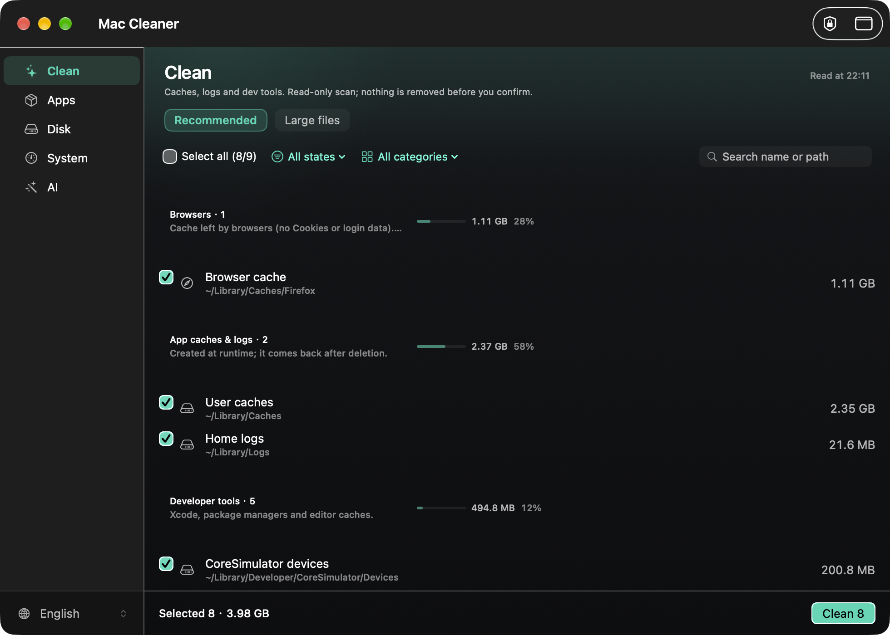

[中文](README.md) · **English**

# For humans



EMM... just an ordinary cleanup tool — tell your AI "use mac cleaner to clean up" and it can call it directly.

# For AI

A macOS cleanup / uninstall / update tool. Three entry points, one kernel:
**scanning is read-only, every deletion goes to the Trash**.

- CLI: `maccleaner audit | plan | clean | uninstall | updates | trace | ui | mcp`
- MCP: `maccleaner-core mcp` (7 tools, stdio) — bundled with the kernel, nothing extra to install
- Native UI: `bash scripts/build_native.sh --run` (SwiftUI; `maccleaner ui` opens it)

Plan first, then apply: `plan_storage` returns a `plan_id`; `apply_storage_plan` requires
`approved_targets`, and the `plan_id` expires after 15 minutes. High-risk targets
(`~/Downloads`, Docker data) need an explicit confirmation. `~/.ssh`, Keychains and browser
login data never show up in the list.

<h1 id="installation">Install</h1>

The native app **does not need Python** — the kernel is bundled inside the `.app` (33 MB, self-contained).
Python 3.10+ is only needed for the CLI, which has no third-party dependencies.

```bash
pipx install maccleaner
```

Not on PyPI yet — install from source:

```bash
pipx install "git+https://github.com/Matoya-Amadeus/MacCleaner.git"
```

For AI clients (MCP): the installed app already provides `maccleaner-core mcp` — no Python package needed.

Build and install the native window: `bash scripts/install_app.sh` → `/Applications/MacCleaner.app`
(falls back to `~/Applications` when not writable)

Build offline artifacts yourself:

```bash
python3 -m pip install wheel
python3 -m build --no-isolation
```


# Usage

## The window

Open `/Applications/MacCleaner.app`, or run `maccleaner ui`. Five entries in the sidebar:

- **Clean**: recommended cleanup (caches / logs / dev tools / containers / your files) + large files
- **Apps**: uninstall (single or batch), updates (grouped by source), orphan leftovers
- **Disk**: capacity, folder breakdown, system-level folders (read-only, one admin prompt)
- **System**: load, memory, battery and throttling, top processes
- **AI**: the catalogue agents can call — 7 MCP tools + stdio commands, and how to wire them up

`⌘1`–`⌘5` switch sections, `⌘R` reloads the page; right-click a row to reveal it in Finder,
copy its path, or uninstall. Dropping a `.app` on the window starts an uninstall.

`⌘A` select all, `Shift+click` range select, `Enter` primary action.

## CLI

```bash
maccleaner audit                      # read-only
maccleaner plan                       # items with target_id / risk / reason
maccleaner clean --apply --yes        # actually remove (low-risk by default)
maccleaner uninstall --app-path /Applications/Foo.app --apply
maccleaner updates --apply --only aom,cmake
maccleaner trace <plan_id>            # what a given plan did
```

## MCP

```json
{"name": "audit_storage", "arguments": {"profile": "generic"}}
{"name": "plan_storage", "arguments": {"profile": "generic"}}
{"name": "apply_storage_plan", "arguments": {
  "plan_id": "<from plan_storage>",
  "approved_targets": ["home-caches"]
}}
```

Client configuration: [docs/mcp.md](docs/mcp.md).

## Verify it yourself

```bash
python3 -m unittest discover -s tests -v
```

GUI acceptance scripts (manual): `bash tests/acceptance_native_app.sh`,
`bash tests/acceptance_portability.sh`, `python3 tests/acceptance_recovery_smoke.py`.
The latest real-click acceptance run is recorded in
[docs/acceptance-2026-10-24.md](docs/acceptance-2026-10-24.md); how the verification itself was
audited is in [docs/acceptance-method-review.md](docs/acceptance-method-review.md); the UI
(gestalt) review is [docs/ux-review-2026-10.md](docs/ux-review-2026-10.md).

## Safety and privacy

No telemetry. The native UI and the kernel talk over stdio only — **no ports, no local server**. See [PRIVACY.md](PRIVACY.md).

---

Maintained jointly by **AI·Maho** and **Human·Matoya**
